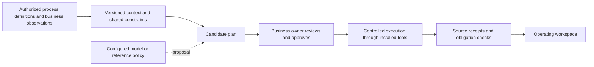
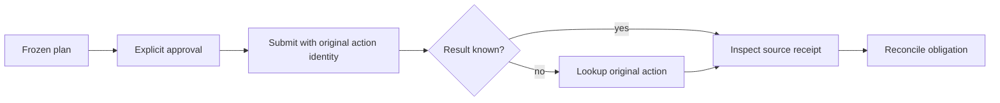
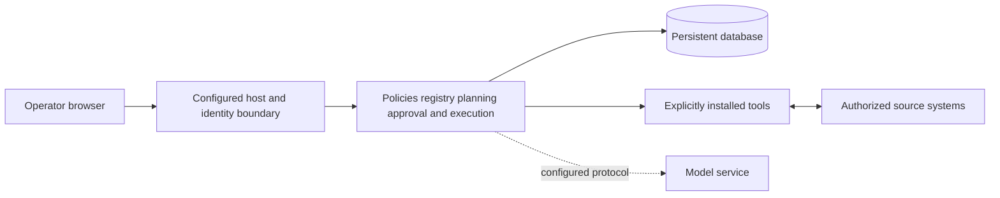

# How the foundation works

[中文](ARCHITECTURE_OVERVIEW.md) · [Home](README.md) · [Extend a source](EXTEND_A_SOURCE.en.md)

Enterprise Brain is a self-hosted foundation for teams building business agents. Existing systems keep their authoritative business records. The foundation stores process revisions, plans, approvals, action identities and receipts. A model may propose work; its answer is not permission to execute or evidence that work happened.

## Business and responsibility

IT confirms structure and installed tools. Business approval is separate. For the beverage reference, production, transfers and co-packing share cash and quality constraints. The 15-domain blueprint provides context; the qualified executable path is supply, not every business area. The reference planner is deterministic; live-model reasoning quality is not established.

## Execution and recovery

Unknown is not failure or success. The runtime retains the action identity and queries its source. This depends on a trusted source's submit/lookup semantics; it is not a universal exactly-once promise. A source receipt, a verified physical receipt, payment and revenue are different facts.

## Deployment boundaries

The source reference launcher uses loopback HTTP and owned constructed sources. It is not an internet production deployment. Enterprise-host HTTPS proxy and initialization have separate contracts. PGlite and native PostgreSQL entry points have different operations scopes; local recovery results do not qualify HA or a new customer host.

## Implementation map

| Responsibility | Implementation |
|---|---|
| Process definitions and revisions | [Registry](src/connectors/process-registry.ts), [MCP reader](src/connectors/mcp-process-reader.ts), [BPMN](src/connectors/bpmn-process.ts), [OData metadata](src/connectors/odata-csdl.ts) |
| Plans and decisions | [Graph service](src/runtime/graph-service.ts), [model planner](src/runtime/graph-planner.ts), [planning ledger](src/runtime/planning-ledger.ts) |
| Tool contract | [GraphTool and catalog](src/runtime/graph-contracts.ts), [minimal adapter](examples/minimal-adapter/inventory-tool.ts) |
| Identity and operations | [Identity](src/identity/service.ts), [operations](src/enterprise/operations.ts) |
| Business reference UI | [Workspace](src/web/app.tsx), [server-state projection](src/web/cockpit/supply-state.ts) |

Current execution uses bounded acyclic graphs. MCP stdio/process contracts, structural BPMN and OData entity metadata do not automatically discover arbitrary IT systems or infer business workflows. A complete enterprise semantic model, arbitrary dynamic agent loops, all 60 stages executable, universal vendor compatibility, live-model organizational insight and production qualification are not established. See [scope](PREVIEW_SCOPE.en.md).

The repository contains three distinct entries: foundation modules, a persistent local reference workspace, and a separate browser-only showcase. The complete signed production installer, maps, dependencies and runtime data are not included. One-step enterprise deployment and broader operator-confirmed discovery remain product goals.

## Bounded onboarding and business-read authority

[First connection](FIRST_CONNECTION.en.md) separates interface evidence, metadata review, read authority and plan-execution approval. Application code explicitly installs the current business-read tool; it is not in the default HTTP catalog.

Scope, version, approval and receipt identities persist. A lost read response is resolved through original-reference lookup without an automatic second GET. Revocation withholds cached business data. Restoration fences new authority and writes its audit in one database transaction; targets start parked. Completed evidence does not become a fresh approval. DNS, IPv6, subnet discovery, credential-backed adapters and complete MCP HTTP are not implemented.
