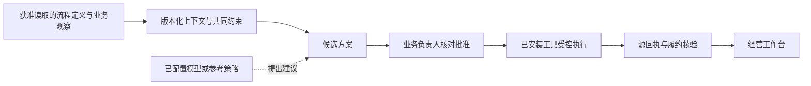
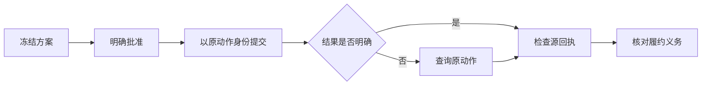
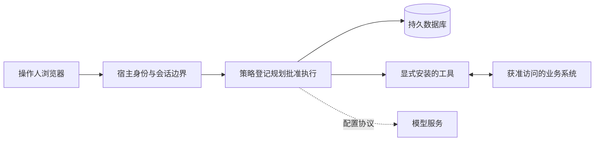

# 技术基座如何工作

[English](ARCHITECTURE_OVERVIEW.en.md) · [首页](README.zh.md) · [扩展一个源](EXTEND_A_SOURCE.md)

Enterprise Brain供企业自建业务Agent团队。现有业务系统保留权威账本；底座保存流程版本、方案、批准、动作身份与回执。模型可以提出建议，但建议不等于操作权限，也不代表业务已经完成。

## 业务与责任边界

IT核对结构和工具安装，业务批准单独记录。饮料参考案例让自产、调拨、代工同时满足现金和质量约束。15域全景保留，当前验证的可执行链路是保供，不是全部业务域。参考规划采用确定性策略，未验证真实模型的推理质量。

## 执行与恢复

未知结果不直接判成功或失败。底座保留原动作身份并向源端查询；可靠性依赖受信源实现submit/lookup语义，不构成对任意系统的普遍exactly-once承诺。源动作回执、实物到货、付款和收入是不同事实。

## 部署边界

源码参考入口只使用回环HTTP与自有构造源，不是公网生产部署。企业宿主的HTTPS代理与初始化有独立合同。PGlite与原生PostgreSQL入口的运维范围不同，本机恢复成绩不代表高可用或新客户宿主资格。

## 源码入口

| 责任 | 实现 |
|---|---|
| 流程与版本 | [登记](src/connectors/process-registry.ts)、[MCP读取](src/connectors/mcp-process-reader.ts)、[BPMN](src/connectors/bpmn-process.ts)、[OData元数据](src/connectors/odata-csdl.ts) |
| 方案与决策 | [图服务](src/runtime/graph-service.ts)、[模型规划](src/runtime/graph-planner.ts)、[规划台账](src/runtime/planning-ledger.ts) |
| 工具合同 | [GraphTool目录](src/runtime/graph-contracts.ts)、[最小适配示例](examples/minimal-adapter/inventory-tool.ts) |
| 身份与运维 | [身份](src/identity/service.ts)、[运维](src/enterprise/operations.ts) |
| 业务参考界面 | [工作台](src/web/app.tsx)、[服务端状态投影](src/web/cockpit/supply-state.ts) |

当前执行采用有界无环图。MCP stdio/流程合同、BPMN结构及OData实体元数据不代表任意IT环境自动发现或自动理解全部业务流程。完整企业语义模型、任意动态Agent循环、全部60环节可执行、任意厂商兼容、真实模型组织洞察和生产资格尚未建立。见[支持范围](PREVIEW_SCOPE.md)。

仓库有三个不同入口：底座模块、持久化本地参考工作台、独立浏览器案例。完整签名生产安装包、地图、依赖安装结果和运行数据不包含在内。一键企业部署和更广泛的操作人确认发现仍是产品目标。
