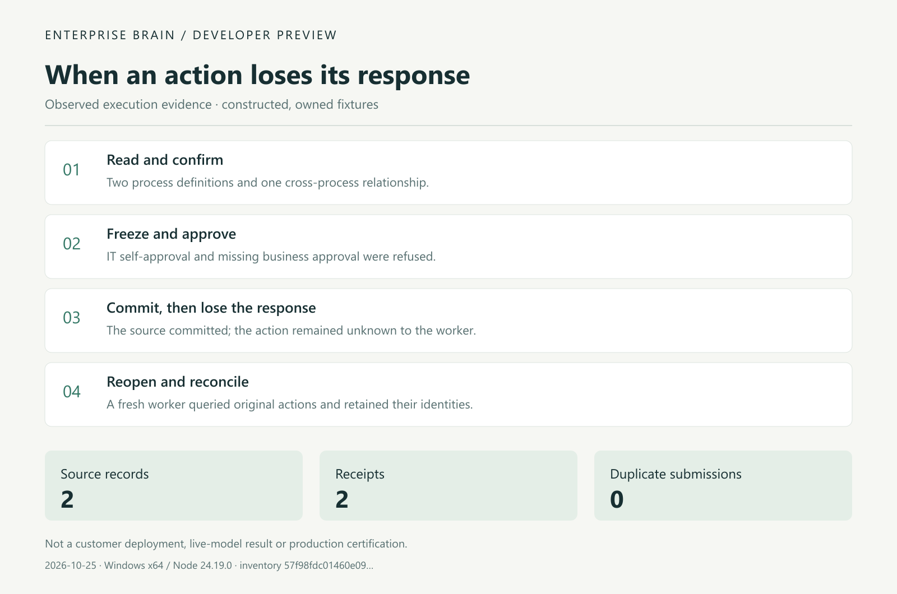

# First-task run record

This graphic summarizes a maintainer-owned local run on2026-10-25: two processes, two actions, two source rows and two receipts, with zero duplicate submissions. It is a historical summary, not a continuous recording, customer deployment or live-model evaluation. See the [original result](examples/observed-result/first-task.json) for its environment and source identifier.

Run the [first task](FIRST_TASK.en.md) to reproduce in your environment. Current release boundaries are in the [validation notes](PREVIEW_NOTES.en.md).
