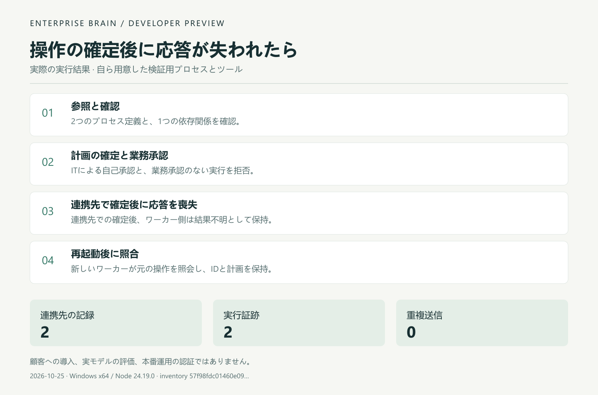

# 実行結果の要約図

[English](DEMO.en.md) · [中文](DEMO.md) · [日本語](DEMO.ja.md)

2026-10-25にメンテナーが自ら用意した検証用タスクを実行した結果です。端末録画、顧客環境への導入、実モデルの評価ではありません。

[JSON](examples/observed-result/first-task.json) · [Run / 运行 / 実行](FIRST_TASK.ja.md) · [Home](README.ja.md)

実行時の元のソース一覧ハッシュはJSONにあります。今回追加するのは文書と図で、実行コード・テスト・ワークフローの内容は同一です。過去の641件の検査を新しい一覧に対する再実行と表明しません。

Windows x64 · Node24.19.0 · processes2 · actions2 · sourceRows2 · receipts2 · duplicateSubmissions0.
