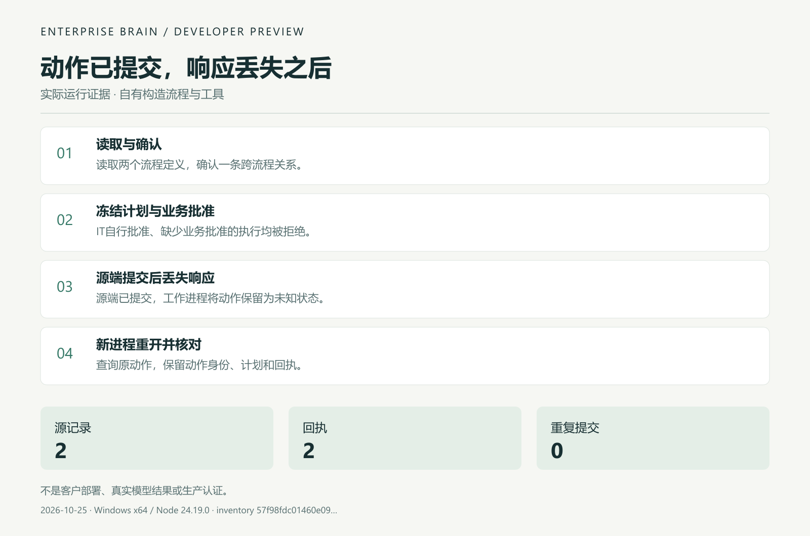

# 实际任务证据，不是产品截图

[English](DEMO.en.md) · [中文](DEMO.md) · [日本語](DEMO.ja.md)

证据图根据2026-10-25一次维护者自有任务运行生成。它不是终端录屏、客户部署或真实模型评测。

[JSON](examples/observed-result/first-task.json) · [Run / 运行 / 実行](FIRST_TASK.md) · [Home](README.zh.md)

运行所用原始源码清单见JSON。本提案增加文档与媒体，可执行源、测试及工作流字节保持；不能把历史641项检查说成本提案新清单另跑的成绩。

Windows x64 · Node24.19.0 · processes2 · actions2 · sourceRows2 · receipts2 · duplicateSubmissions0.
