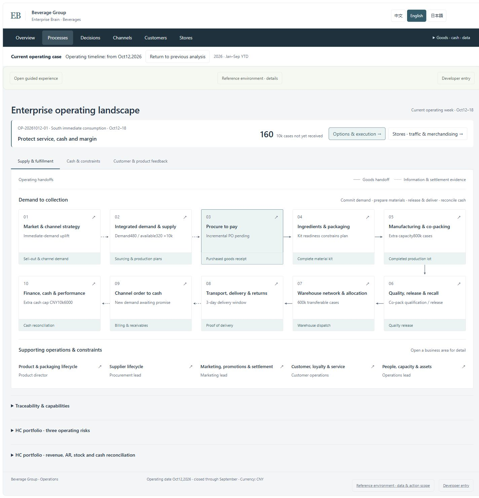
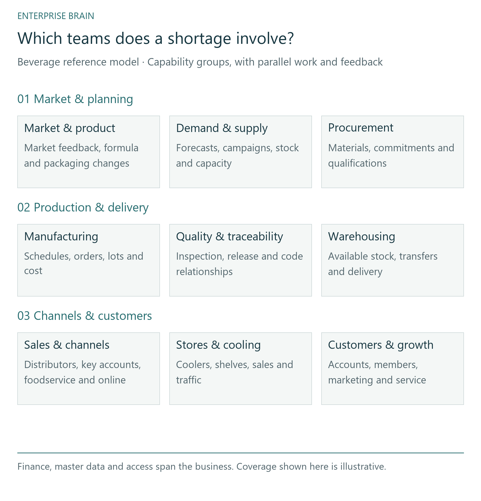
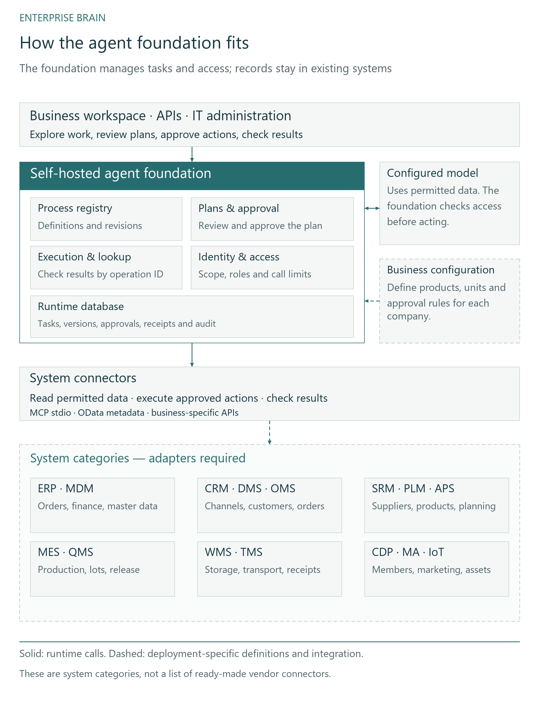
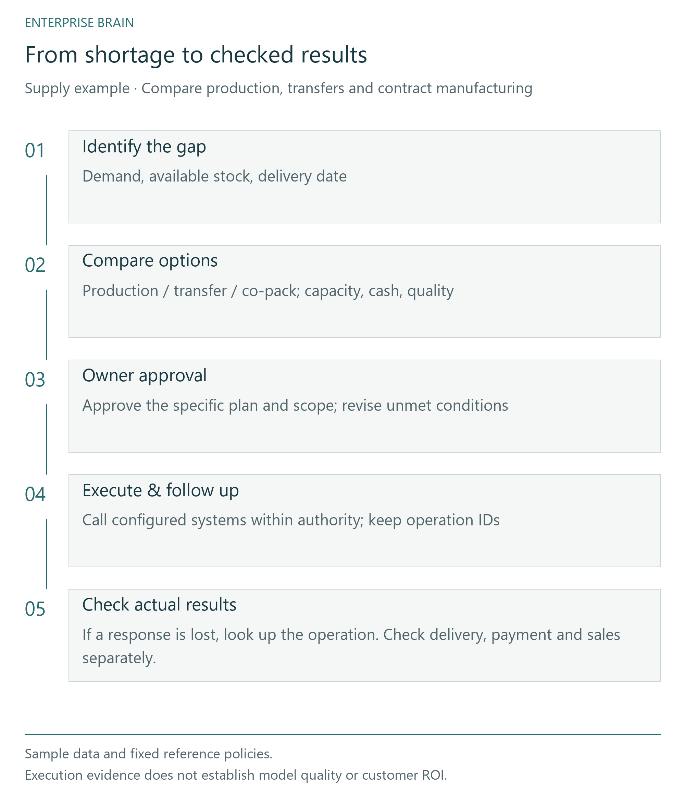

# Enterprise Brain

**A self-hosted foundation for enterprise AI agents**

[English](README.md) · [中文](README.zh.md) · [日本語](README.ja.md)

Build agents that work across business systems: read the relevant information, review a plan with its owner, then execute it and check the result. ERP, CRM and other systems continue to hold their business records.

[Explore the business case](https://pygmalionsong.github.io/enterprise-brain-community/?lang=en) · [Run a task locally](FIRST_TASK.en.md) · [Architecture diagrams](docs/ARCHITECTURE.en.md) · [Discuss and contact](CONTACT.en.md)

## Try the business case

A beverage business faces a supply shortage. Compare production, warehouse transfers and contract manufacturing against delivery, cash and quality constraints. Explore the process overview, then drill into a business area or store.

[Explore the beverage case](https://pygmalionsong.github.io/enterprise-brain-community/?lang=en)



## Run a task locally

The first task reads two sample processes, requests approval and executes a plan. It also tests recovery when a system saves a change but its response is lost. Sample data is included; no company account or model API key is needed.

[Run the first task](FIRST_TASK.en.md)

## Bring a cross-team problem into one decision

A shortage involves demand, stock, capacity, delivery and cash. The case shows how those responsibilities connect while each system keeps its records.

[](docs/diagrams/business.en.svg)

## Infrastructure your team can build on

The foundation stores processes, checks access, and records approved plans and their results. Each company configures its system adapters, products, units and approval rules. Models propose work; the software checks access before execution.

[](docs/diagrams/systems.en.svg)

## Follow a plan through to its result

The supply case compares production, transfers and co-packing under shared capacity, cash and quality constraints. Approval, system acceptance and physical receipt remain separate. Payment and sales require their own evidence.

[](docs/diagrams/decision.en.svg)

## Developer guides

- [Run the local supply case](RUN_OPERATING_CASE.en.md)
- [Architecture](ARCHITECTURE_OVERVIEW.en.md)
- [Adapt a data source](EXTEND_A_SOURCE.en.md)
- [Connect a system](FIRST_CONNECTION.en.md)
- [FAQ](FAQ.en.md)

## Install and run

Node 24.19.0 · pnpm 11.25.0

```sh
node scripts/verify-repository.mjs
pnpm install --frozen-lockfile --ignore-scripts
pnpm typecheck
pnpm build
node scripts/start-reference.mjs --acknowledge-owned-fixture
```

## Release status

This is a developer source preview. Windows x64 and Ubuntu 24.04 x64 source checks have run. Connecting a company system requires an adapter and access configuration; automatic network-wide discovery and a production one-click installer are not available.

The browser case uses sample data and runs separately from the local backend. Production deployment, live-model quality and customer outcomes have not been validated.

[Scope](PREVIEW_SCOPE.en.md) · [Validation](PREVIEW_NOTES.en.md)

## Discuss and contribute

Ask integration questions in Discussions, report reproducible bugs in Issues, or propose a change through a Pull Request. For bug reports, use sample data and remove account details and API keys.

[Discussions](https://github.com/PygmalionSong/enterprise-brain-community/discussions) · [Issues](https://github.com/PygmalionSong/enterprise-brain-community/issues) · [Contact](CONTACT.en.md) · [Security](SECURITY.en.md)

## License

Source and examples use Apache-2.0. When redistributing, retain the applicable copyright, license and NOTICE statements.

[LICENSE](LICENSE) · [NOTICE](NOTICE) · [Third-party notices](THIRD_PARTY_NOTICES.en.md) · [Attribution](ATTRIBUTION.en.md)

PygmalionSong · [Project background](STORY.en.md)
