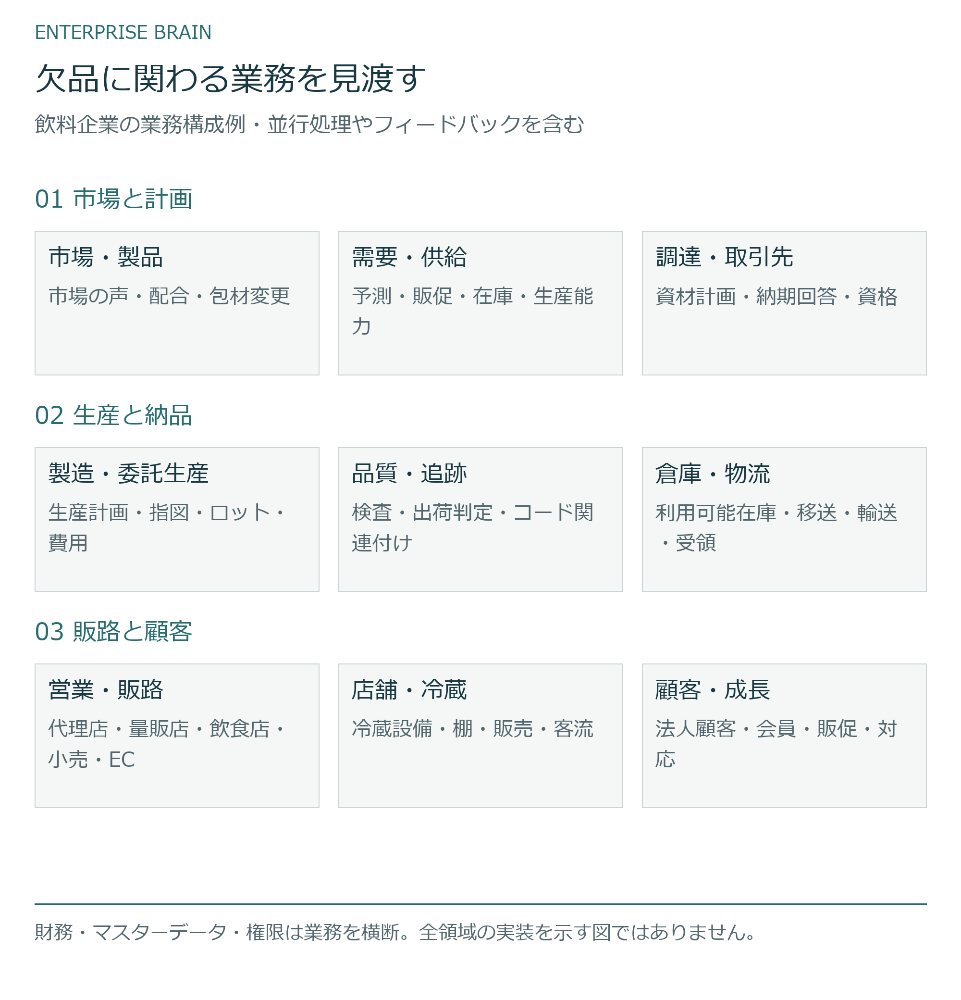
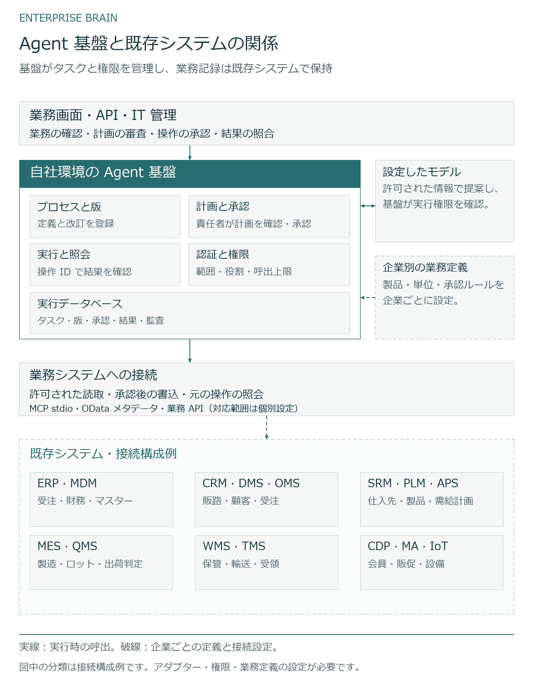
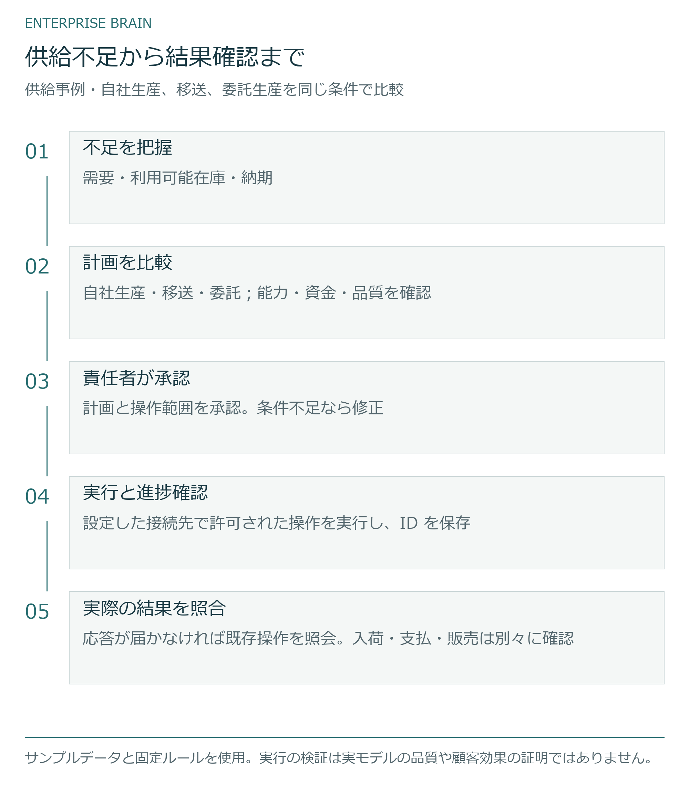

# Enterprise Brain

**企業向け AI Agent のセルフホスト基盤**

[English](README.md) · [中文](README.zh.md) · [日本語](README.ja.md)

複数の業務システムから情報を読み取り、責任者が計画を確認・承認した後に実行結果を照合する Agent の基盤です。ERP や CRM など、既存システムの業務記録はそのまま利用します。

[業務事例を見る](https://pygmalionsong.github.io/enterprise-brain-community/?lang=ja) · [タスクを実行](FIRST_TASK.ja.md) · [構成図](docs/ARCHITECTURE.ja.md) · [質問・連絡先](CONTACT.ja.md)

## 業務事例を体験

飲料企業の供給不足に対し、納期・資金・品質の条件を踏まえて自社生産・倉庫間移送・委託生産を比較します。業務全体から各領域や店舗へ掘り下げて確認できます。

[飲料企業の事例を開く](https://pygmalionsong.github.io/enterprise-brain-community/?lang=ja)


## ローカルでタスクを実行

二つのサンプルプロセスを読み取り、承認後に計画を実行します。接続先で処理が完了しても応答が届かない場合の復旧も試せます。サンプルデータを同梱しており、企業アカウントやモデル API キーは不要です。

[最初のタスクを実行](FIRST_TASK.ja.md)

[独立ホストの初期設定から結果確認まで試す](GETTING_STARTED.ja.md)

## 部門をまたぐ課題を一緒に考える

供給不足には需要・在庫・生産能力・納期・資金が関わります。事例で業務間の関係を確認できます。各システムは引き続き業務記録を管理します。

[](docs/diagrams/business.ja.svg)

## チームが再利用できる基盤

基盤が業務プロセスを保存し、操作権限と承認を確認して実行結果を記録します。接続先、製品、単位、承認ルールは企業ごとに設定します。モデルの提案を実行する前に、プログラムが権限を確認します。

[](docs/diagrams/systems.ja.svg)

## 計画から実行結果まで追う

供給事例では、生産能力・資金・品質の条件をそろえて自社生産・移送・委託生産を比較します。承認・システム受付・入荷は別に確認し、支払と販売にはそれぞれの証憑が必要です。

[](docs/diagrams/decision.ja.svg)

## 開発者ガイド

- [供給事例をローカル実行](RUN_OPERATING_CASE.ja.md)
- [構成（英語）](ARCHITECTURE_OVERVIEW.en.md)
- [データソースの拡張](EXTEND_A_SOURCE.ja.md)
- [業務システムへの接続](FIRST_CONNECTION.ja.md)
- [よくある質問](FAQ.ja.md)

## インストールと実行

Node 24.19.0 · pnpm 11.25.0

```sh
node scripts/verify-repository.mjs
pnpm install --frozen-lockfile --ignore-scripts
pnpm typecheck
pnpm build
node scripts/start-reference.mjs --acknowledge-owned-fixture
```

## バージョンの状況

現在は開発者向けソースプレビューです。Windows x64 と Ubuntu 24.04 x64 でソース検証を実施しています。企業システムへの接続にはアダプターと権限設定が必要です。ネットワーク全体の自動探索と本番向けワンクリックインストーラーは未提供です。

ブラウザー事例はサンプルデータを使い、ローカルバックエンドとは独立して動きます。本番導入、実モデルの品質、顧客の業務成果は未検証です。

[対応範囲（英語）](PREVIEW_SCOPE.en.md) · [検証記録（英語）](PREVIEW_NOTES.en.md)

## 質問・貢献

接続の相談は Discussions、不具合の報告は Issues、コードや文書の改善は Pull Request を利用してください。報告にはサンプルデータを使い、アカウント情報や API キーを含めないでください。

[Discussions](https://github.com/PygmalionSong/enterprise-brain-community/discussions) · [Issues](https://github.com/PygmalionSong/enterprise-brain-community/issues) · [お問い合わせ](CONTACT.ja.md) · [セキュリティー（英語）](SECURITY.en.md)

## ライセンス

ソースとサンプルは Apache-2.0 です。再配布時には適用される著作権、ライセンス、NOTICE の表記を保持してください。

[LICENSE](LICENSE) · [NOTICE](NOTICE) · [第三者表記（英語）](THIRD_PARTY_NOTICES.en.md) · [出典表記](ATTRIBUTION.ja.md)

PygmalionSong · [プロジェクトの背景](STORY.ja.md)
