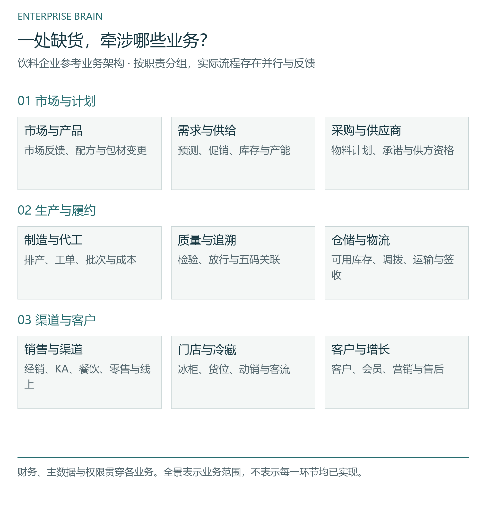
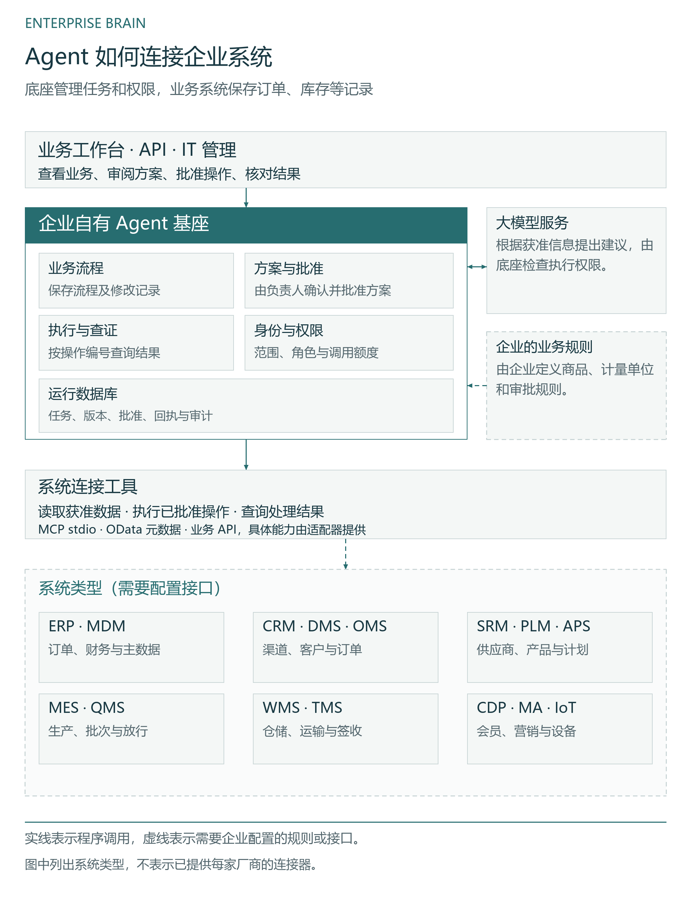
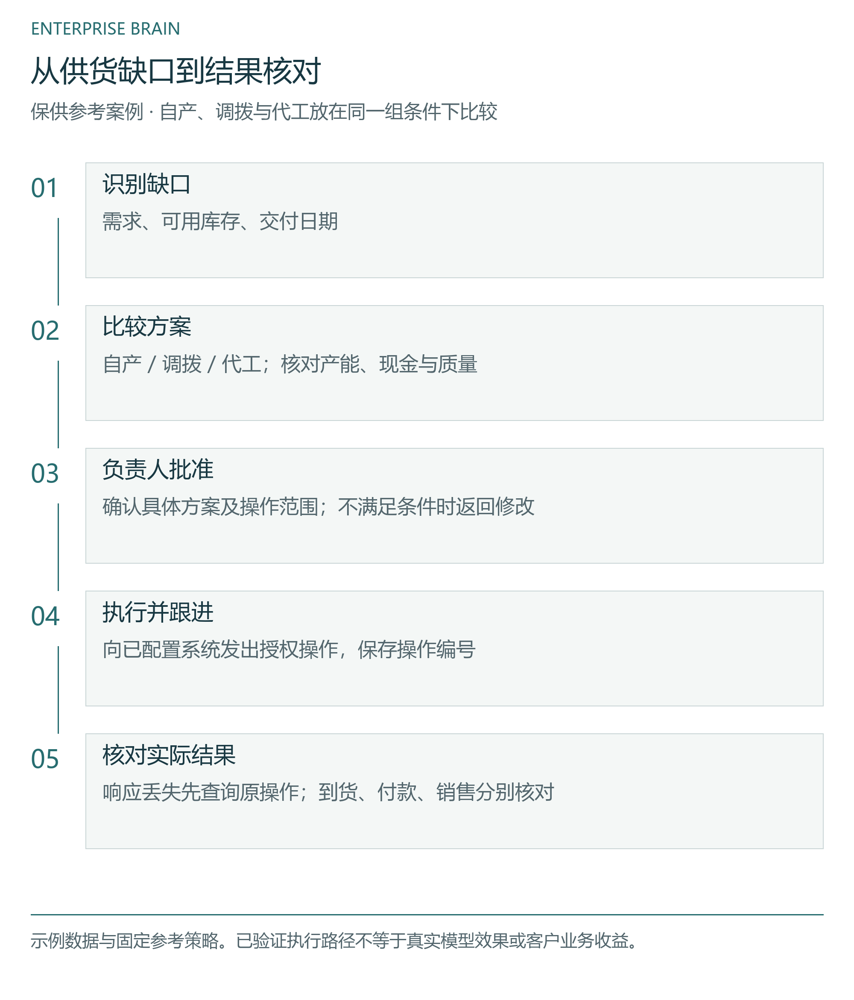

# Enterprise Brain

**企业级 AI Agent 的私有化技术基座**

[English](README.md) · [中文](README.zh.md) · [日本語](README.ja.md)

让 Agent 处理跨系统业务：读取相关信息，与负责人核对方案，批准后执行，再检查结果。ERP、CRM 等原有系统继续管理各自的业务记录。

[查看业务案例](https://pygmalionsong.github.io/enterprise-brain-community/?lang=zh) · [本地上手指南](GETTING_STARTED.zh.md) · [图示架构](docs/ARCHITECTURE.zh.md) · [交流与联系](CONTACT.md)

## 先看一个业务案例

饮料企业出现供货缺口，如何在交期、现金和质量约束下选择自产、仓库调拨或代工？从业务全景进入，查看各业务环节和门店经营。

[体验饮料企业案例](https://pygmalionsong.github.io/enterprise-brain-community/?lang=zh)


## 在本地试一条任务

样例会生成自己的账号和数据，无需企业账号或模型密钥。

| 你想验证什么 | 从这里开始 |
|---|---|
| 配置宿主、批准任务，重启后查询原操作 | [完整上手指南](GETTING_STARTED.zh.md) |
| 操作响应丢失后查证结果，避免重复提交 | [双进程恢复任务](FIRST_TASK.md) |
| 修改库存源，对比新数据和原操作记录 | [库存适配示例](EXTEND_A_SOURCE.md) |

## 跨部门的问题，放在一起判断

供货缺口要同时看销售需求、库存、产能、交期和现金。案例展示这些业务怎样关联；各系统仍负责自己的记录。

[](docs/diagrams/business.zh.svg)

## 企业团队可以复用哪些基础设施

底座保存业务流程、检查操作权限，并记录方案的批准和执行结果。接入一家企业时，还需要配置系统接口、商品和计量单位，以及这家企业的审批规则。模型负责提出建议，执行前仍由程序检查权限。

[](docs/diagrams/systems.zh.svg)

## 方案怎样走到结果

保供案例在同一组产能、现金和质量条件下比较自产、调拨与代工。批准、系统受理和到货分别核对；付款和销售需要各自的业务凭据。

[](docs/diagrams/decision.zh.svg)

## 开发者指南

- [本地运行保供案例](RUN_OPERATING_CASE.zh.md)
- [技术架构](ARCHITECTURE_OVERVIEW.md)
- [适配数据源](EXTEND_A_SOURCE.md)
- [接入业务系统](FIRST_CONNECTION.md)
- [常见问题](FAQ.zh.md)

## 准备运行环境

Node 24.19.0 · pnpm 11.25.0

```sh
node scripts/verify-repository.mjs
pnpm install --frozen-lockfile --ignore-scripts
pnpm typecheck
pnpm build
```

## 版本状态

当前提供开发者源码预览，已执行 Windows x64 和 Ubuntu 24.04 x64 源码检查。接入企业系统需要适配器和权限配置；全网自动发现和生产级一键安装器尚未提供。

浏览器案例使用示例数据，与本地后端独立运行。生产部署、真实模型质量和客户业务收益尚未验证。

最新指南和修复位于 main。preview.2 附件是较早的源码快照；运行独立宿主样例请使用当前源码。

[支持范围](PREVIEW_SCOPE.md) · [验证记录](PREVIEW_NOTES.md)

## 交流与贡献

接入问题在 Discussions 交流，可复现错误提交 Issue，代码和文档改进通过 Pull Request 提交。反馈问题时，请使用示例数据，并隐去账号、密钥等敏感信息。

[Discussions](https://github.com/PygmalionSong/enterprise-brain-community/discussions) · [Issues](https://github.com/PygmalionSong/enterprise-brain-community/issues) · [联系维护者](CONTACT.md) · [安全政策](SECURITY.md)

## 许可

源码与案例采用 Apache-2.0。再分发时，请保留适用的版权、许可和 NOTICE 声明。

[LICENSE](LICENSE) · [NOTICE](NOTICE) · [第三方声明](THIRD_PARTY_NOTICES.en.md) · [来源说明](ATTRIBUTION.zh.md)

PygmalionSong · [项目背景](STORY.md)
